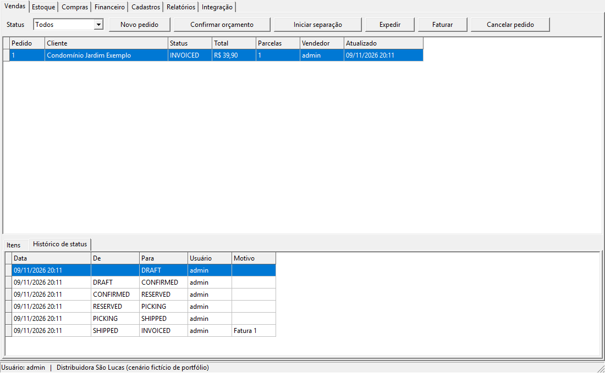
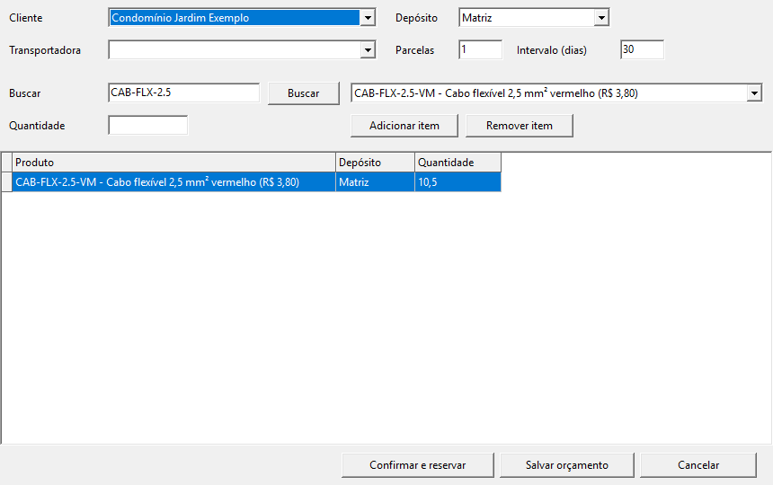
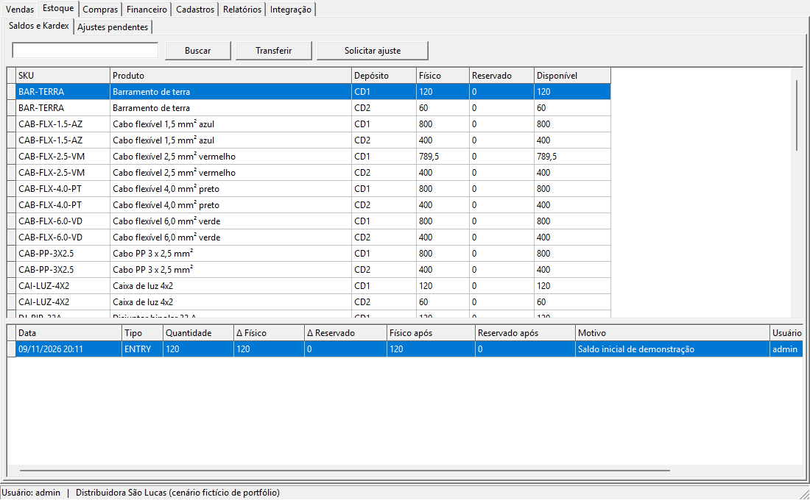
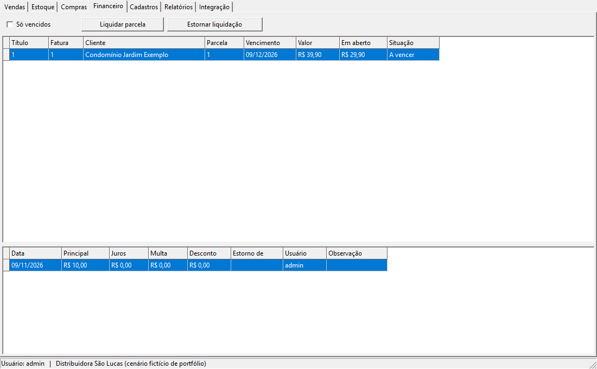
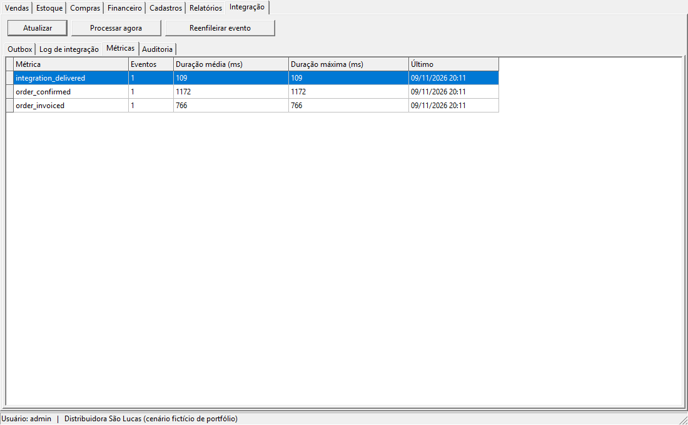
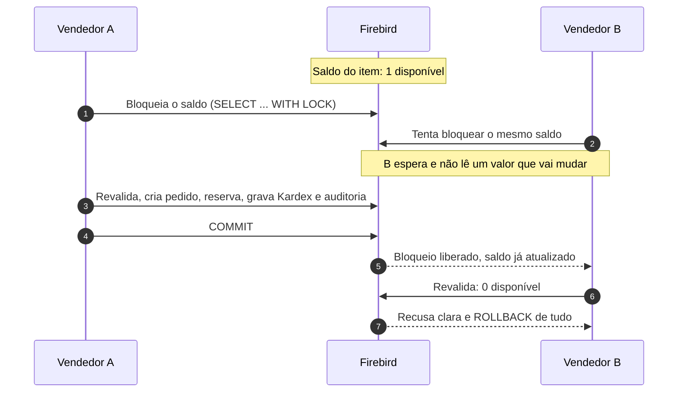
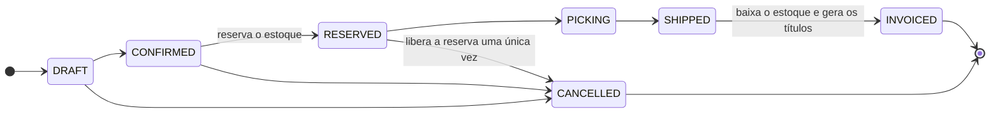
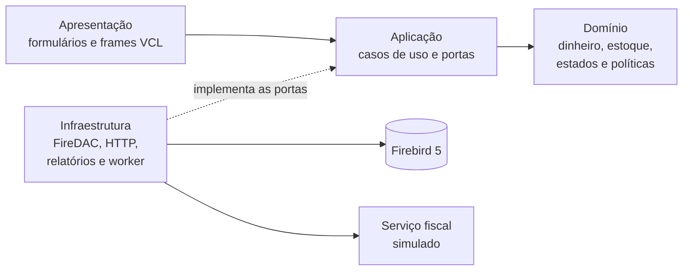

<div align="center">

# EnterpriseFlow ERP

**ERP desktop para uma distribuidora de materiais elétricos: vendas, estoque, compras e financeiro,<br>com foco em consistência quando dois usuários disputam o mesmo registro e quando a rede falha.**

[](https://github.com/wasdevv/enterpriseflow-erp/actions/workflows/ci.yml)


</div>

> [!NOTE]
> A **Distribuidora São Lucas** e todos os dados são fictícios. Este é um projeto de portfólio, não uma implantação comercial.

> [!WARNING]
> **Ainda não compilado em Delphi.** Foi desenvolvido sem acesso a um compilador Delphi. O código compila também com Free Pascal e Lazarus, e foi assim que tudo foi testado, inclusive como `.exe` nativo no Windows. Os adaptadores FireDAC e `TNetHTTPClient` e a aparência na VCL estão pendentes. O que foi provado e como: [docs/verificacao-delphi.md](docs/verificacao-delphi.md).

<p align="center">
  
  <br>
  <sub>Pedido percorrendo o fluxo inteiro, com o histórico de cada transição. Capturas do <code>.exe</code> de Windows compilado com Free Pascal e Lazarus, que usa os mesmos controles nativos da VCL.</sub>
</p>

## Em números

| 150 testes | 52 verificações | 16 de 16 | 4 índices |
|:---:|:---:|:---:|:---:|
| passando em Linux e como `.exe` no Windows, contra Firebird real | de ponta a ponta nas telas, com controles nativos do Windows | sabotagens detectadas pelos testes | adotados depois de medidos, 2 rejeitados |

## O problema e a resposta

| Problema da distribuidora | Como o sistema trata |
|---|---|
| Dois vendedores vendem a última unidade ao mesmo tempo | A transação bloqueia o saldo e revalida a disponibilidade. Um vence; o outro recebe uma recusa clara, e nada dele fica gravado |
| Saldo registrado diverge do físico | Kardex imutável com motivo, usuário e documento de origem, e relatório que reconcilia o saldo com a soma dos movimentos |
| Alterações sem rastro | Auditoria só de inserção, com identificador de correlação. Preço e limite de crédito guardam o valor anterior |
| Pagamento parcial e estorno | Liquidação validada no domínio e no banco. O estorno cria um lançamento compensatório e preserva o original |
| Pedido sem status confiável | Uma máquina de estados decide toda transição, com histórico. Nem SQL direto tira um pedido faturado do lugar |
| Serviço externo instável | Evento gravado na mesma transação do faturamento (outbox), retry só quando é seguro e chave de idempotência |

## Telas

<table>
  <tr>
    <td width="50%"><br><sub><b>Novo pedido.</b> Cabo vendido por metro aceita fração; preço vem do cadastro e é revalidado na confirmação.</sub></td>
    <td width="50%"><br><sub><b>Estoque e Kardex.</b> Físico, reservado e disponível por depósito, com cada movimento do item.</sub></td>
  </tr>
  <tr>
    <td width="50%"><br><sub><b>Financeiro.</b> Liquidação parcial abatendo o saldo em aberto da parcela.</sub></td>
    <td width="50%"><br><sub><b>Integração.</b> Outbox, log das chamadas, métricas e auditoria.</sub></td>
  </tr>
</table>

## Como a corrida pela última unidade é resolvida



Os bloqueios seguem sempre a mesma ordem (cliente, pedido e saldos por produto e depósito), o que evita deadlock mesmo quando os itens são digitados em ordem diferente. A repetição de uma confirmação com a mesma chave devolve o pedido já criado. A recusa vira métrica numa transação própria, para sobreviver ao rollback. Os detalhes estão no [ADR de bloqueio](docs/adr/002-isolamento-e-bloqueio.md).

## Ciclo de vida do pedido



## Arquitetura



As dependências apontam para dentro: o domínio não conhece banco nem tela, e os formulários não têm SQL nem regra de negócio. Dinheiro é inteiro em centavos, nunca ponto flutuante.

```text
src/presentation     formulários e frames (DFM)
src/application      casos de uso e interfaces de repositório
src/domain           valores, entidades, regras e exceções
src/infrastructure   banco, repositórios, HTTP, relatórios e worker da outbox
database             migrations com checksum e dados de demonstração
tests                unidade, integração e roteiro de telas, com a API do DUnitX
```

## O que os testes pegaram

Nenhum destes aparecia em teste unitário:

- **Limite de crédito nunca aplicado.** No Firebird 4+, `SUM` de `NUMERIC(18,2)` é INT128, que o driver entregava como `NULL` e o código lia como zero. Agora valor ilegível gera erro em vez de virar zero ([ADR 004](docs/adr/004-dinheiro-e-valor-ilegivel.md)).
- **Administrador sem nenhuma permissão.** `UNION` de literais vira `CHAR`, e os códigos gravados vinham com espaços à direita, que o banco ignora e o aplicativo não.
- **Filtro opcional que desligava o índice.** `(:p = '' OR status = :p)` mantinha o plano sem índice ([medição](docs/performance.md)).
- **Testes fracos.** Na primeira rodada de sabotagem, 3 alterações passaram despercebidas, entre elas tirar o bloqueio do cliente. Os testes foram reforçados até pegar as 16.
- **Falha rara de conexão.** Em 3 de cerca de 1.000 corridas sob carga, o driver do Free Pascal falhava ao conectar em paralelo. Um teste só de conexões provou a causa antes da correção.

## Módulos

| Módulo | O que tem |
|---|---|
| **Cadastros** | Produtos, categorias, clientes, fornecedores, transportadoras, depósitos e endereços, usuários e perfis; CPF e CNPJ validados |
| **Compras** | Pedido, recebimento parcial ou total, entrada vinculada ao documento, divergências |
| **Estoque** | Reserva, transferência atômica, ajuste aprovado por outra pessoa, Kardex imutável, reconciliação |
| **Vendas** | Orçamento, confirmação com reserva, limite de crédito, separação, expedição, cancelamento |
| **Financeiro** | Fatura interna, parcelas sem perda de centavo, juros, multa e desconto, estorno, títulos vencidos, fluxo de caixa |
| **Integração** | Outbox com worker em segundo plano, retry só quando seguro, log sem segredos |
| **Observabilidade** | Log JSON com correlação, duração das operações e métricas de recusas e falhas |

## Como executar

**Requisitos:** Firebird 5.0 (exigido por `SKIP LOCKED` e índice parcial). Para a versão Delphi, Delphi 12 ou 13; para verificar sem Delphi, Free Pascal 3.2.2 e Lazarus 3 ou 4.

**Usuários de demonstração**, todos com a senha `demo1234`: `admin`, `vendedor1`, `vendedor2`, `vendedor3`, `estoque`, `financeiro` e `gerente`.

<details>
<summary><b>Banco de dados</b></summary>

```bash
docker compose up -d    # Firebird na porta 3050 e serviço fiscal simulado na 8765
```

Copie `config/enterpriseflow.ini.example` para `config/enterpriseflow.ini` e preencha, ou use as variáveis `EF_DB_*`. Com o Docker, o caminho do banco é `/var/lib/firebird/data/enterpriseflow.fdb`.

```bash
efmigrate create
efmigrate migrate
efmigrate seed database/seeds/001_demo.sql
```

</details>

<details>
<summary><b>Em Delphi</b></summary>

Abra `EnterpriseFlow.dproj` e compile, ou rode `scripts\windows\build-delphi.ps1`. Na primeira vez, siga o [roteiro de verificação](docs/verificacao-delphi.md#compilar-em-delphi), porque ajustes são esperados. A edição gratuita deve atender com o Firebird em `localhost`.

</details>

<details>
<summary><b>No Windows, sem Delphi</b></summary>

`scripts/package-windows.sh`, rodado no WSL, gera uma pasta com o `.exe` compilado com Free Pascal e Lazarus. O arquivo `Abrir EnterpriseFlow.bat` sobe o banco de demonstração no WSL e abre o programa.

</details>

<details>
<summary><b>Testes</b></summary>

```bash
sudo apt install fpc lcl lcl-gtk2 libgtk2.0-dev xvfb
./scripts/setup-firebird.sh          # Firebird 5 no diretório do usuário, porta 53050
./scripts/test.sh                    # unidade e integração
./scripts/ui-smoke.sh ./capturas     # roteiro nas telas, com capturas opcionais
./scripts/mutation-check.py          # confere que os testes detectam sabotagem
./scripts/check-delphi-rules.py      # regras que só o Delphi cobra
```

Com `fp-units-win-*` e `lazarus-src` instalados, `scripts/test-windows.sh` e `scripts/ui-smoke-windows.sh` rodam o mesmo pelo WSL, como `.exe` nativo no Windows.

</details>

## Decisões

| Documento | Assunto |
|---|---|
| [ADR 001](docs/adr/001-verificacao-sem-delphi.md) | O mesmo código em Delphi e Free Pascal, e o que isso não prova |
| [ADR 002](docs/adr/002-isolamento-e-bloqueio.md) | Isolamento, bloqueio e ordem global contra deadlock |
| [ADR 003](docs/adr/003-politicas-de-dominio.md) | Políticas de negócio que a especificação deixava em aberto |
| [ADR 004](docs/adr/004-dinheiro-e-valor-ilegivel.md) | Dinheiro em centavos e leitura que falha em vez de virar zero |
| [ADR 005](docs/adr/005-outbox.md) | Outbox, idempotência e retry |
| [Índices](docs/performance.md) | Cada índice medido com e sem, em volume sintético |

## Limitações

- Sem compilação em Delphi, como descrito acima.
- Contas a pagar estão fora do escopo: o fluxo de caixa só tem entradas.
- Relatórios em tela e CSV, sem layout de impressão.
- O serviço externo é simulado, e a fatura é interna, sem nota fiscal.
- Edição de cadastro não detecta alteração simultânea: vence o último a salvar, com o histórico na auditoria.
- Sem licença definida, por isso o repositório é privado.

## Roadmap

- [x] Estrutura em camadas, projeto VCL e migrations
- [x] Autenticação, permissões e bloqueio por tentativas
- [x] Cadastros, compras, estoque e Kardex
- [x] Reserva concorrente, pedido de venda e cancelamento
- [x] Faturamento, contas a receber, auditoria e outbox
- [x] Integração REST simulada e relatórios
- [x] Testes de unidade, integração, telas e sabotagem
- [x] Execução como `.exe` nativo no Windows (Free Pascal e Lazarus)
- [ ] Compilar e validar em Delphi ([como](docs/verificacao-delphi.md#compilar-em-delphi))
- [ ] Gravar demonstração

<sub>A especificação de partida está em [docs/especificacao.md](docs/especificacao.md).</sub>
